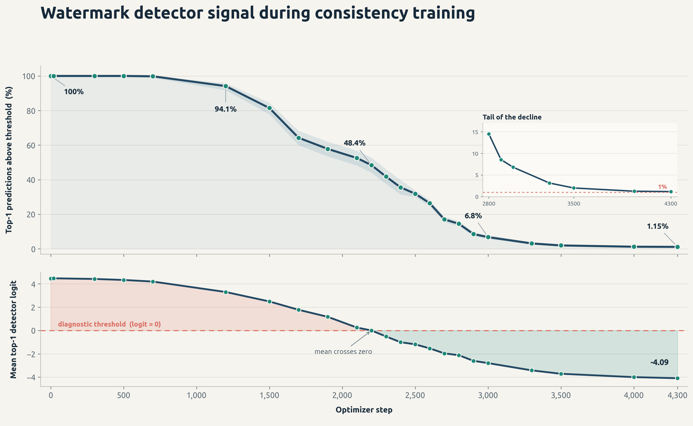

# Blitz

**Accelerating structure prediction through diffusion-model distillation.**

Blitz distills biomolecular structure-prediction models into deterministic
8-step (K8) and 16-step (K16) students. The released **Boltz-2** students retain
accuracy comparable to the teacher on the reported complex-structure benchmark
while using far fewer denoiser evaluations. **K16 is the recommended default.**

This repository includes inference checkpoints and training and evaluation code.
The distillation method was also tested with AlphaFold 3, although only Boltz-2
student weights are distributed here.

## SynthID Bio research experiment

In a separate AlphaFold 3 experiment, consistency training removed nearly all
of the signal measured by the watermark detector: the fraction of top-ranked
predictions classified as watermarked fell from 100% at initialization to
1.15% after 4,300 optimizer steps.

More broadly, watermarking methods for generative structure models should treat
post-training model adaptation, including consistency training, as part of
their threat model.

We do not publish an operational scorer, detector parameters, or checkpoint
extraction code. AlphaFold 3 training code and weights are also not included.
For transparency,
[`scripts/synthid_bio/`](scripts/synthid_bio/) retains only our
implementation of the architecture in supplementary Listing 1 of
[Stutz et al. (*Nature*, 2026)](https://doi.org/10.1038/s41586-026-10965-y).



[Quickstart](docs/blitz/QUICKSTART.md) ·
[Results](docs/blitz/RESULTS.md) ·
[Training](docs/blitz/TRAINING.md) ·
[Training data](docs/blitz/DATA.md) ·
[Model provenance](docs/blitz/PROVENANCE.md)

## Installation

Use a fresh environment with **Python 3.10–3.12**. Clone the `main` branch:

```bash
git clone --branch main https://github.com/EpiGenomicsCode/Blitz.git
cd Blitz
python -m pip install -e '.[cuda]'
python -m pip install huggingface_hub
```

For CPU-only or non-CUDA hardware, replace `'.[cuda]'` with `'.'`; CPU inference
is substantially slower.

## Run a prediction

### 1. Download the checkpoints

The [Hugging Face release](https://huggingface.co/vinaymatt/Blitz-Boltz2)
contains complete K8 and K16 prediction models.

```bash
hf download vinaymatt/Blitz-Boltz2 \
  blitz-boltz2-k8.ckpt blitz-boltz2-k16.ckpt SHA256SUMS \
  --local-dir checkpoints

(cd checkpoints && sha256sum -c SHA256SUMS)
```


### 2. Prepare the input

Create `input.yaml` using the [Boltz input format](docs/prediction.md).
See [`examples/`](examples/) for sample inputs. For protein inputs, supply the
required MSAs or add `--use_msa_server` to generate them through the MSA server.

### 3. Run K16

```bash
boltz predict input.yaml \
  --model boltz2 \
  --checkpoint checkpoints/blitz-boltz2-k16.ckpt \
  --blitz_policy k16 \
  --recycling_steps 5 \
  --diffusion_samples 5 \
  --seed 1 \
  --out_dir predictions-k16
```

For K8, use `blitz-boltz2-k8.ckpt` with `--blitz_policy k8`.

The `--blitz_policy` flag loads the matching sampling schedule and endpoint
geometry correction, and sets `--sampling_steps` to 8 or 16. 
These are the documented benchmark inference settings. 

## Benchmark results

Results on the [Boltz-2 benchmark](https://doi.org/10.1101/2025.06.14.659707)
of approximately 2,300 targets:

| System | Model | NFE | Complex lDDT ↑ | RF-valid ↑ | DockQ ↑ | Ligand RMSD ↓ | Any violation ↓ |
|---|---|---:|---:|---:|---:|---:|---:|
| AlphaFold 3 | teacher | 200 | 0.8615 | 41.5% | 0.4198 | 6.63 Å | 9.8% |
| AlphaFold 3 | Blitz K8 | 8 | **0.8635** | 40.5% | **0.4207** | **6.44 Å** | 11.3% |
| AlphaFold 3 | Blitz K16 | 16 | **0.8634** | **42.3%** | 0.4167 | **6.51 Å** | **6.8%** |
| Boltz-2 | teacher | 600 | 0.8499 | 98.5% | 0.3929 | 9.00 Å | 30.3% |
| Boltz-2 | Blitz K8 | 8 | 0.8492 | 93.7% | 0.3897 | **8.75 Å** | 41.9% |
| Boltz-2 | Blitz K16 | 16 | **0.8533** | 94.1% | **0.3932** | **8.78 Å** | **26.7%** |


NFE denotes denoiser evaluations.  

## Training

Blitz fine-tunes the Boltz-2 structure module using **discrete multistep
consistency distillation (MSCD)**. The trunk, confidence model, and affinity
model remain frozen. Training starts from the released Boltz-2 weights, which
also provide the teacher targets.

Set the data-path variables described in the [training guide](docs/blitz/TRAINING.md),
then run the launcher:

```bash
./scripts/train/run_mscd.sh k8 \
  --output runs/k8 \
  --teacher-checkpoint /path/to/boltz2_conf.ckpt \
  --devices 4 \
  --accumulate 32
```

Use `k16` for the 16-step student. Under a distributed launcher, the 32-GPU
configuration is `--nodes 8 --devices 4 --accumulate 4`. The launcher checks
the required data paths and accepts additional OmegaConf overrides as
`key=value` arguments. The released training implementation targets Boltz-2;
no AlphaFold 3 training code or weights are included. See:

- [Training](docs/blitz/TRAINING.md) for schedules, optimizer settings, and checkpoint selection.
- [Configurations](scripts/train/configs/) for the supplied training configs.
- [Training data](docs/blitz/DATA.md) for preparation of the RCSB and AlphaFold DB corpora.
- [Provenance](docs/blitz/PROVENANCE.md) for model lineage and the limitations of the reconstructed K8 training configuration.

## Evaluation

Evaluation and aggregation scripts are in [`scripts/eval/`](scripts/eval/),
including `run_evals.py`, `aggregate_evals.py`, and `physcialsim_metrics.py`.
See [Results](docs/blitz/RESULTS.md) for the benchmark comparison and its
relationship to the Boltz-2 evaluation protocol.

## Repository layout

| Path | Contents |
|---|---|
| `src/boltz/` | Model, data pipeline, and command-line interface |
| `src/boltz/model/potentials/blitz.py` | K8/K16 deterministic sampling policies |
| `src/boltz/consistency/` | MSCD training code |
| `scripts/train/` | Training launcher, configurations, and ID splits |
| `scripts/process/` | RCSB and AlphaFold DB data processing |
| `scripts/eval/` | Benchmark evaluation and aggregation |
| `scripts/synthid_bio/` | Watermark-detector architecture used in the SynthID Bio experiment |
| `docs/blitz/` | Quickstart, results, training, data, and provenance |
| `examples/` | Example prediction inputs |

## License and acknowledgments

Blitz builds on [Boltz](https://github.com/jwohlwend/boltz). The repository code
is distributed under the [MIT License](LICENSE), with upstream attribution
preserved. Boltz-2 model weights are released under MIT.

AlphaFold 3 parameters are subject to separate Google DeepMind terms and are
not included.

## Citation
Please also cite the relevant upstream Boltz work below. The SynthID Bio
experiment refers to [Stutz et al.](https://doi.org/10.1038/s41586-026-10965-y).

```bibtex
@article{passaro2025boltz2,
  author = {Passaro, Saro and Corso, Gabriele and Wohlwend, Jeremy and Reveiz, Mateo and Thaler, Stephan and Somnath, Vignesh Ram and Getz, Noah and Portnoi, Tally and Roy, Julien and Stark, Hannes and Kwabi-Addo, David and Beaini, Dominique and Jaakkola, Tommi and Barzilay, Regina},
  title = {Boltz-2: Towards Accurate and Efficient Binding Affinity Prediction},
  year = {2025},
  doi = {10.1101/2025.06.14.659707},
  journal = {bioRxiv}
}

@article{wohlwend2024boltz1,
  author = {Wohlwend, Jeremy and Corso, Gabriele and Passaro, Saro and Getz, Noah and Reveiz, Mateo and Leidal, Ken and Swiderski, Wojtek and Atkinson, Liam and Portnoi, Tally and Chinn, Itamar and Silterra, Jacob and Jaakkola, Tommi and Barzilay, Regina},
  title = {Boltz-1: Democratizing Biomolecular Interaction Modeling},
  year = {2024},
  doi = {10.1101/2024.11.19.624167},
  journal = {bioRxiv}
}
```

If you use automatic MSA generation, also cite ColabFold:

```bibtex
@article{mirdita2022colabfold,
  title={ColabFold: making protein folding accessible to all},
  author={Mirdita, Milot and Sch{\"u}tze, Konstantin and Moriwaki, Yoshitaka and Heo, Lim and Ovchinnikov, Sergey and Steinegger, Martin},
  journal={Nature methods},
  year={2022},
}
```
